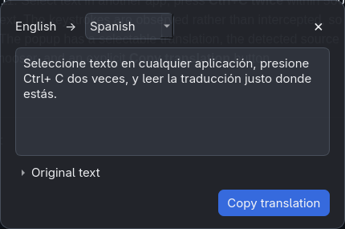
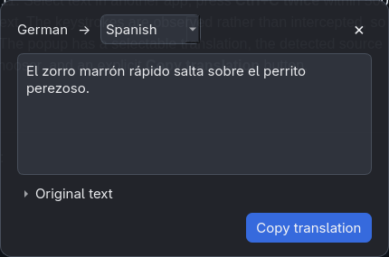

# Interpres (ClipTranslate)

A small background translation app for Windows 10/11. Select text in another app, press **Ctrl+C twice** within 500 ms, and a popup near the pointer translates the copied text. The keystrokes are observed rather than intercepted, so the source app still performs its normal copy operation. The popup has a selectable translation, the detected source language, a collapsible original, a target language chooser, and an explicit **Copy translation** button.

<p>
  
  
</p>

The popup shows the detected source language, a target language chooser, the selectable translation, a collapsible original text, and a **Copy translation** button.

## Setup

Install Python 3.12+, [uv](https://docs.astral.sh/uv/), and Git. From this directory:

```powershell
uv sync
uv run interpres
```

The default provider is **local**. It uses [Argos Translate](https://github.com/argosopentech/argos-translate) for translation and [py3langid](https://github.com/adbar/py3langid) for language detection. The first use of a language pair downloads and installs its model pack and any needed sentence model; the popup shows these steps. Once installed, that pair translates offline, and selected text is never sent to a translation service. For another machine with no internet access, copy the Argos data directory, including its `packages` and `minisbd` subdirectories.

The app runs in the system tray. Right-click its icon to enable or disable the hook, choose a target language, open settings, or quit.

Argos currently needs an upstream commit for its lightweight MiniSBD path; this project pins that commit in `pyproject.toml`. `uv sync` therefore needs Git and internet access on the initial install. The app does not download Python packages at runtime.

### Optional DeepL provider

Set `provider = "deepl"` in the config file and restart. Get an **API Free** or Pro key from the **API Keys** tab of a [DeepL API account](https://www.deepl.com/pro-api). Set `DEEPL_API_KEY` in your environment before starting the app; on PowerShell, use `$env:DEEPL_API_KEY = "your-key-here"`. You can also put `api_key = "..."` in the config file; the environment variable takes precedence. Keep the config file private. In this mode, copied text is sent to DeepL after the double-copy gesture.

The [DeepL authentication guide](https://developers.deepl.com/docs/getting-started/auth) documents the Free and Pro hosts and key format. The [translation endpoint](https://developers.deepl.com/api-reference/translate/request-translation) documents automatic language detection when `source_lang` is omitted.

## Settings

Use **Open settings** in the tray menu to create and open the file. Its location is `%APPDATA%\ClipTranslate\config.toml` on Windows, `~/Library/Application Support/ClipTranslate/config.toml` on macOS, and `$XDG_CONFIG_HOME/cliptranslate/config.toml` (or `~/.config/cliptranslate/config.toml`) on Linux.

```toml
target_language = "EN"
double_press_ms = 500
clipboard_delay_ms = 125
max_text_length = 5000
popup_timeout_ms = 0 # 0 keeps the popup open
theme = "system" # system, light, or dark
provider = "local" # local or deepl
auto_download_models = true # only downloads missing language packs
local_device = "cpu" # cuda requires a working CUDA runtime
# api_key = "your-key-here"
```

Restart after changing settings. Changing target language in the popup or tray takes effect immediately and saves that one setting. The popup starts a new translation whenever its target changes. Recent text and target pairs are cached in memory for the current session. Argos keeps model packs in its user data directory; set `ARGOS_PACKAGES_DIR` if you want a different location. Set `auto_download_models = false` to guarantee the app never fetches a missing pack.

CPU works without a GPU. `local_device = "cuda"` is optional and requires compatible CUDA user libraries in addition to an NVIDIA driver. A driver alone does not provide those libraries.

## Tests

```powershell
uv run --group dev python -m pytest -q
```

The tests mock both translation providers and do not require an API key or model download. To check the UI locally, run the app on a desktop session, copy text from a second application twice, then test edge placement and outside-click dismissal. Automated tests cannot prove that a global hook sees elevated or protected application windows.

## Package for Windows

Install PyInstaller into a packaging environment, then from this directory:

```powershell
uv run --with pyinstaller pyinstaller --noconfirm --onefile --windowed --name Interpres --collect-all pynput --collect-all argostranslate --collect-all minisbd --collect-all py3langid scripts/cliptranslate.py
```

The executable is placed in `dist/Interpres.exe`. Model packs are stored separately in the user data directory and are downloaded on first use; they are not bundled into the executable. Run it once before adding it to startup. To start on login, press `Win+R`, enter `shell:startup`, and place a shortcut to the executable in that folder. PyInstaller builds are platform-specific; build on Windows for Windows.

## Known limitations and next steps

- Windows global hooks may not see secure desktops, UAC prompts, or some elevated applications when the app runs unelevated. Test those workflows on the target machine.
- Linux support is aimed at X11. Wayland generally restricts global keyboard and mouse hooks and clipboard access; a portal or compositor-specific integration is needed.
- macOS may require Accessibility and Input Monitoring permission. The listener recognizes Command+C there, but the Windows experience is the supported target.
- Short text can be misidentified by the local language detector. A future source-language override would help.
- Some pairs use English as an intermediate language, which can reduce quality. Future versions can offer model management and show the route used.
- The language menu is a useful subset of available model targets. A future version can populate it from installed packs.
- The app does not restore clipboard history or copy a translation automatically. A future settings UI could also replace editing the TOML file.

Logs rotate in the same user config directory as `cliptranslate.log`. They record operational failures without clipboard text or API keys.

## Linux / Wayland

Global key hooks (pynput) only see XWayland windows. On Hyprland, add this to `~/.config/hypr/bindings.lua`; it reports every Ctrl+C to the app (the key still reaches your app, and terminals are skipped). Needs `socat`, `jq` and `wl-clipboard`:

```lua
o.bind("CTRL + C", "Interpres", "/path/to/interpres/scripts/interpres-trigger", { non_consuming = true })
```

The app listens on `$XDG_RUNTIME_DIR/interpres-copy`. Only one instance runs at a time.

Local models are downloaded over HTTPS from the public Argos package index, which publishes no checksums, so they are not integrity-checked.
