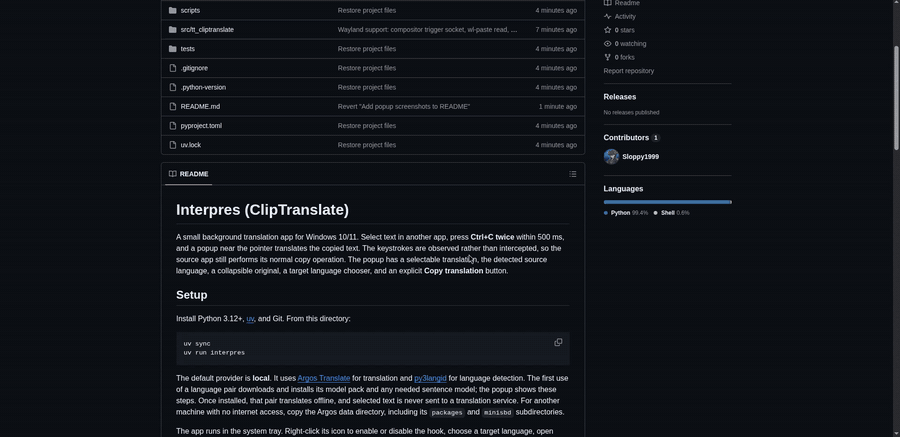

# Interpres (ClipTranslate)

A small background translation app for Linux. Select text in another app, press **Ctrl+C twice** within 500 ms, and a popup near the pointer translates the copied text. The keystrokes are observed rather than intercepted, so the source app still performs its normal copy operation. The popup has a selectable translation, the detected source language, a collapsible original, a target language chooser, and an explicit **Copy translation** button.



## Install on Arch / Omarchy

Build and install the package from this repo (needs `git` and `uv`):

```bash
git clone https://github.com/Sloppy1999/interpres.git
cd interpres/packaging
makepkg -si
systemctl --user enable --now interpres
```

Then add the Hyprland binding from the Wayland section below, using the installed command `interpres-trigger`. The service starts the app on login.

## Setup (from source)

Install Python 3.12+, [uv](https://docs.astral.sh/uv/), and Git. From this directory:

```bash
uv sync
uv run interpres
```

The default provider is **local**. It uses [Argos Translate](https://github.com/argosopentech/argos-translate) for translation and [py3langid](https://github.com/adbar/py3langid) for language detection. The first use of a language pair downloads and installs its model pack and any needed sentence model; the popup shows these steps. Once installed, that pair translates offline, and selected text is never sent to a translation service. For another machine with no internet access, copy the Argos data directory, including its `packages` and `minisbd` subdirectories.

The app runs in the system tray. Right-click its icon to enable or disable the hook, choose a target language, open settings, or quit.

Argos currently needs an upstream commit for its lightweight MiniSBD path; this project pins that commit in `pyproject.toml`. `uv sync` therefore needs Git and internet access on the initial install. The app does not download Python packages at runtime.

### Optional DeepL provider

Set `provider = "deepl"` in `~/.config/cliptranslate/config.toml` (or `$XDG_CONFIG_HOME/cliptranslate/config.toml`) and restart. Get an **API Free** or Pro key from the **API Keys** tab of a [DeepL API account](https://www.deepl.com/pro-api). Run `export DEEPL_API_KEY="your-key-here"` before starting the app. You can also put `api_key = "..."` in the config file; the environment variable takes precedence. Keep the config file private. In this mode, copied text is sent to DeepL after the double-copy gesture.

## Wayland (Hyprland)

Global key hooks (pynput) only see XWayland windows. On Hyprland, add this to `~/.config/hypr/bindings.lua`; it reports every Ctrl+C to the app (the key still reaches your app, and terminals are skipped). Needs `socat`, `jq` and `wl-clipboard`:

```lua
o.bind("CTRL + C", "Interpres", "interpres-trigger", { non_consuming = true })
```

The app listens on `$XDG_RUNTIME_DIR/interpres-copy`. Only one instance runs at a time.

Using a source checkout instead of the package? Point the binding at `scripts/interpres-trigger` with its full path.

## Known limitations

- Windows and macOS are not supported for now.
- On X11 the global hook works directly. On Wayland only Hyprland is covered, through the binding above; other compositors need their own integration.
- Short text can be misidentified by the local language detector.
- Some pairs use English as an intermediate language, which can reduce quality.
- Local models are downloaded over HTTPS from the public Argos package index, which publishes no checksums, so they are not integrity-checked.

Logs rotate in `~/.config/cliptranslate/cliptranslate.log`. They record operational failures without clipboard text or API keys.

## License

MIT, see `LICENSE`.
